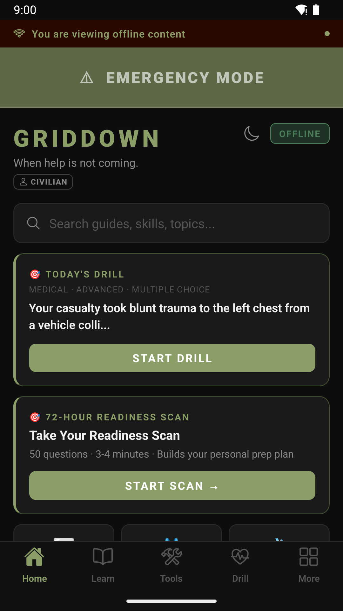
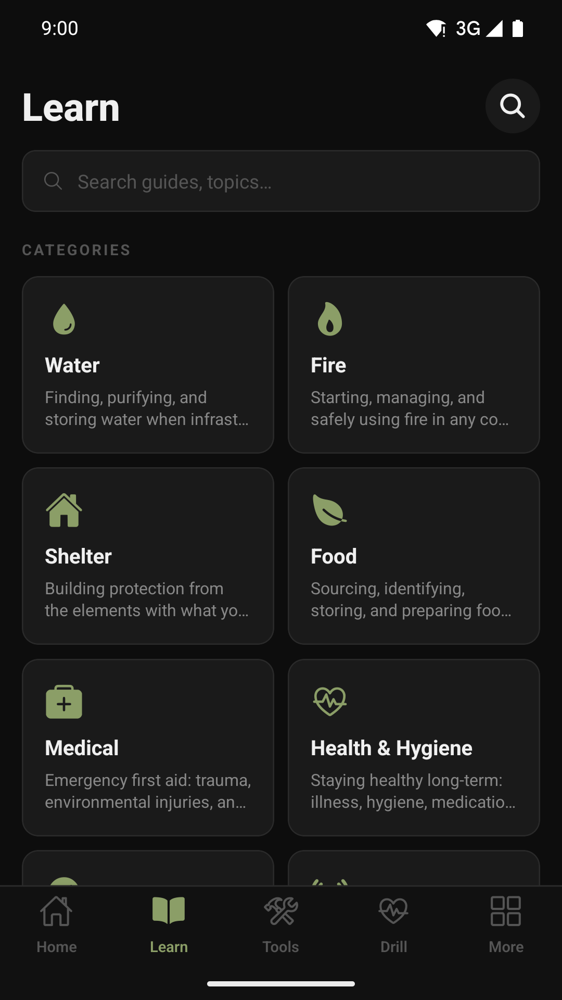
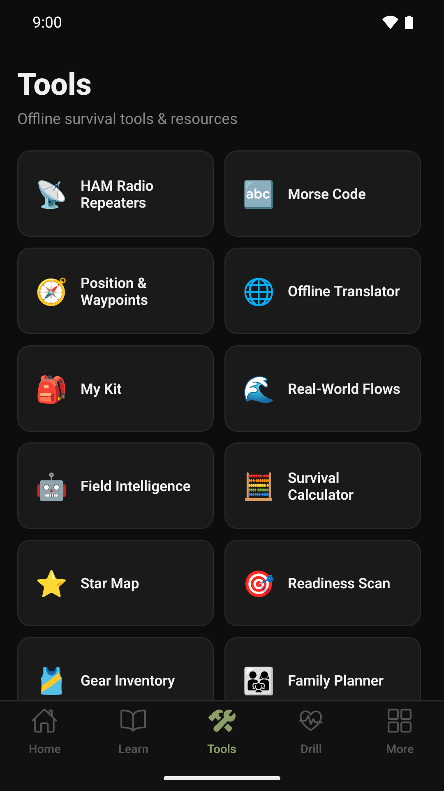
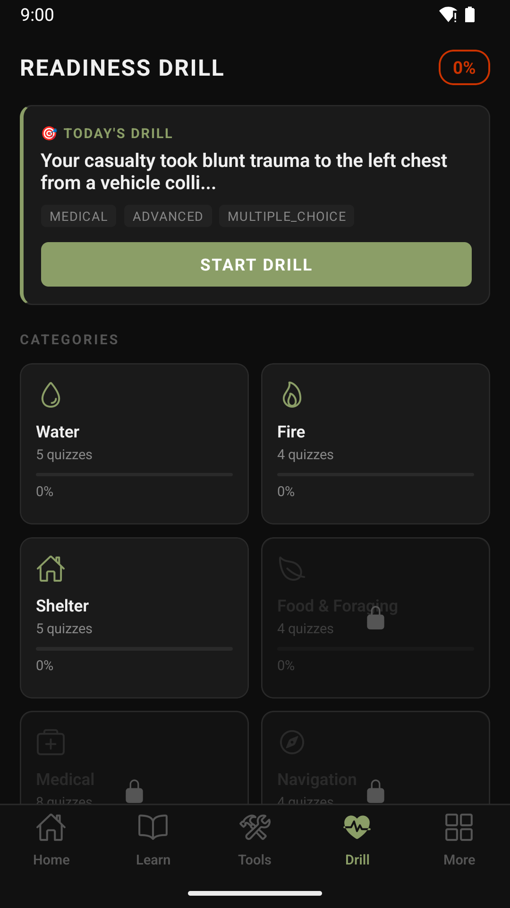
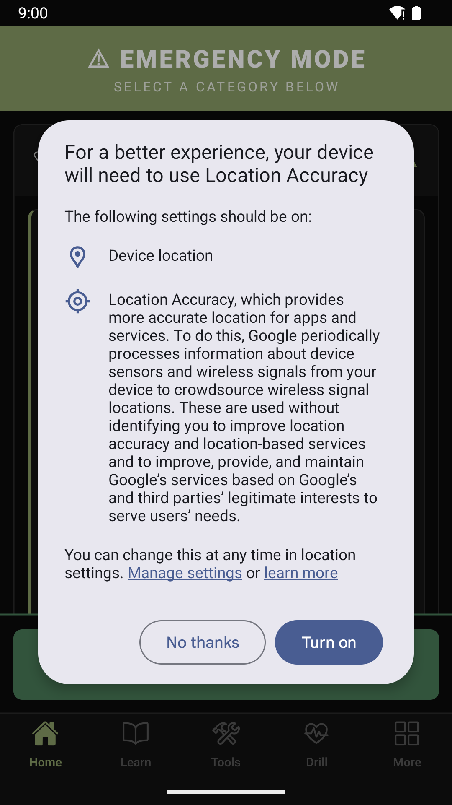
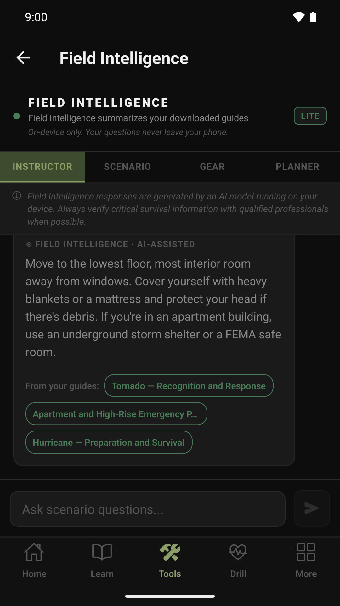

# GridDown (GDS)

**Tactical survival intelligence for when the grid goes down.**

GridDown is a React Native app (Expo SDK 57, Android + iOS) delivering 315 offline survival guides in 19 categories, Emergency Mode, 196 quizzes, 15+ offline tools and an on-device AI advisor — zero network required for content. Content comes from `E:\Projects\GridDown-Library` (see *Working layout* in `store-assets/LAUNCH_CHECKLIST.md`).

---

## Screenshots

| Home | Learn | Tools | Drill | Emergency | Advisor |
|---|---|---|---|---|---|
|  |  |  |  |  |  |

Marketing overview PDF: `E:\Projects\GridDown\_exports\marketing\GridDown-Product-Overview.pdf`.

---

## Features

- **100% offline-first** — all content stored on-device via SQLite, no network required
- **315 guides, 19 categories** — water, fire, shelter, food, medical, health & hygiene, navigation, comms, security, tools & kits, disaster, grid-down home, terrain & climate, vehicle, homesteading, power, urban, leadership, children; each with cited `sources[]`
- **Emergency Mode** — large-print crisis cards, SOS, live GPS/MGRS (always free)
- **Priority ranking** — guides sorted Critical → Advanced → Beginner
- **Full-text search** — in-memory scored index with 150ms debounce
- **Tactical checklists** — pre-built and persistable via SQLite
- **Bookmark system** — SQLite-backed, instant access
- **On-device AI advisor** — llama.rn running Phi-3.5 Mini or Qwen2.5-1.5B locally (Pro + AI)
- **RevenueCat purchases** — Free / Pro / Pro + AI, every gate in `app/config/access.ts`
- **Dark tactical UI** — `#0D0D0D` background, `#8B9E67` accent

---

## Tech Stack

| Layer | Technology |
|---|---|
| Framework | Expo SDK 57 + React Native 0.86 (New Architecture, Hermes), React 19.2 |
| Language | TypeScript (strict) |
| Navigation | React Navigation 6 (bottom tabs + stack) |
| State | Zustand |
| Database | expo-sqlite (WAL mode) |
| Subscriptions | RevenueCat (react-native-purchases ^10) |
| On-device AI | llama.rn + Phi-3.5 Mini (2.4 GB) or Qwen2.5-1.5B (1.1 GB), guide-grounded (BM25) |
| File system | expo-file-system |
| Location | expo-location |
| Icons | @expo/vector-icons (Ionicons) |
| Build | Local Gradle (`scripts/build-android.ps1`) / Xcode on the Mac mini — no EAS |
| CI | GitHub Actions |

---

## Project Structure

```
GridDown/
├── app/
│   ├── assets/
│   │   ├── content/          # JSON guide data (10 category files)
│   │   ├── checklists/       # Checklist template JSON
│   │   └── images/           # Generated app icons + splash
│   ├── components/
│   │   ├── CategoryGrid.tsx  # Home screen category grid (Ionicons)
│   │   ├── EmergencyBanner.tsx
│   │   ├── GuideCard.tsx
│   │   └── SearchBar.tsx
│   ├── db/
│   │   └── contentLoader.ts  # SQLite init + CRUD (bookmarks, history, checklists, tier)
│   ├── navigation/
│   │   └── AppNavigator.tsx  # Bottom tab + stack navigator
│   ├── screens/              # 13 production screens
│   ├── store/
│   │   └── useAppStore.ts    # Zustand global store
│   ├── theme/
│   │   └── colors.ts         # Color constants
│   └── utils/
│       ├── guideRegistry.ts  # Guide data access layer
│       ├── checklistRegistry.ts
│       ├── purchases.ts      # RevenueCat wiring
│       ├── revenueCat.ts
│       ├── search.ts         # In-memory full-text search index
│       └── helpers.ts
├── scripts/
│   ├── generate-assets.js    # sharp-based icon/splash generator
│   └── patch-content.js      # Content completeness patch
├── store-assets/
│   └── STORE_LISTING.md      # App Store + Play Store copy
├── .github/
│   └── workflows/
│       └── ci.yml            # Lint + TypeScript + Test CI
├── App.tsx                   # Root — bootstrap + navigator
├── app.json                  # Expo config
├── eas.json                  # EAS Build profiles
└── tsconfig.json
```

---

## Screens

| Screen | Description |
|---|---|
| HomeScreen | Category grid + emergency banner |
| CategoryScreen | Guide list with priority filter (Critical/Advanced/Beginner) |
| GuideScreen | Full guide render — steps, warnings, pro tips, bookmarking |
| SearchScreen | Full-text search with debounce, grouped by category |
| ChecklistScreen | Interactive survival checklists with persistent state |
| MapScreen | Position & waypoints — live GPS in lat/long, UTM, MGRS (no map tiles) |
| AdvisorScreen | llama.rn on-device AI (Pro + AI) with download flow |
| PaywallScreen | Subscription purchase UI via RevenueCat |
| CommunityScreen | Discord community (hidden: `COMMUNITY_ENABLED = false`) |
| ContentPacksScreen | Downloadable content pack browser |
| FounderScreen | Founder tier perks |
| ReferralScreen | Referral program (hidden: `REFERRAL_PROGRAM_ENABLED = false`) |
| SettingsScreen | App preferences |

---

## Plans & paywalls

| Plan | Internal tiers | Unlocks |
|---|---|---|
| Free | `free` | All 315 guides, Emergency Mode, offline tools, checklists, kits, flows, Family Planner, Water/Fire/Shelter quizzes |
| Pro | `monthly`, `yearly`, `lifetime_standard` | + every quiz category, HAM repeater database |
| Pro + AI | `extreme_monthly`, `extreme_yearly`, `extreme_lifetime` | + Field Intelligence on-device AI |

- **Switchboard:** `app/config/access.ts` → `FEATURE_TIER`. Changing one value puts a feature behind Pro or Pro + AI; `FeatureGate` / `gated()` already render the lock card + "See plans" for every feature. Medical, Water/Fire/Shelter and every Emergency Mode guide can never lock.
- **Test builds:** `.\scripts\build-android.ps1 -Target release -Apk -UnlockAll` → `E:\Projects\GridDown\_exports\GridDown-<ver>-TEST-unlocked.apk` with every gate open and a yellow "TEST BUILD" banner. `.\scripts\test-on-pc.ps1 -Test` installs it on the emulator. A Play bundle can't be built with the flag on. The browser preview is always unlocked.
- **Products/entitlements:** `app/config/products.ts`; go-live steps in `store-assets/REVENUECAT_SETUP.md`.

---

## Guide Content

### Categories and Counts
| Category | Guides |
|---|---|
| Water | 16 |
| Fire | 15 |
| Shelter | 12 |
| Food | 14 |
| Medical | 53 |
| Health & Hygiene | 17 |
| Navigation | 14 |
| Comms | 16 |
| Security | 17 |
| Tools & Kits | 12 |
| Disaster | 26 |
| Grid-Down Home | 16 |
| Terrain & Climate | 16 |
| Vehicle | 14 |
| Homesteading | 14 |
| Power & Energy | 11 |
| Urban Survival | 11 |
| Leadership | 9 |
| For Children | 12 |
| **Total** | **315** |

Generated from GridDown-Library 2.0.0 (`app/assets/content/library-manifest.json`). Don't hand-edit `app/assets/content/*.json`; edit the library and re-sync.

### Content Schema
```json
{
  "id": "category-001",
  "category": "category",
  "title": "Guide Title",
  "priority": "critical | advanced | beginner",
  "tags": ["tag1", "tag2"],
  "summary": "One-sentence description.",
  "requiresMedicalDisclaimer": true,
  "steps": [{ "step": 1, "title": "Step Title", "body": "Step body..." }],
  "warnings": ["Warning text..."],
  "proTips": ["Pro tip text..."],
  "relatedGuides": ["category-002"]
}
```

---

## Development Setup

### Prerequisites (all free)
- Node.js 24 (`C:\Program Files\nodejs`)
- **Android:** JDK 21 (`E:\Tools\jdk-21`), Android SDK at `E:\Android\Sdk` with platforms 34/36,
  build-tools 36, **NDK 27.1.12297006** and **cmake 3.22.1** (required by React Native 0.86 + llama.rn)
- **iOS:** a Mac with Xcode 16+, CocoaPods, and an Apple Developer account ($99/yr — the only paid item)
- No EAS account is required. Everything below builds locally at zero cost.

### Install
```powershell
git clone https://github.com/RCeasar01/GridDown.git E:\Projects\GridDown
cd E:\Projects\GridDown
npm ci
```

### Run (JS-only dev loop)
```powershell
npx expo start
```
> `llama.rn` and ML Kit translation are native modules, so the **Advisor** and **Translator**
> only run in a dev-client or store build — not in Expo Go. In Expo Go the Advisor shows a
> labelled DEV demo mode and the Translator falls back to the pre-translated phrase cards.

### Try the app (no build needed)
| Where | How | What works |
|---|---|---|
| **Any browser** | <https://rceasar01.github.io/GridDown/> — rebuilt by CI on every push to `main` | Guides, quizzes, checklists, flows, tools, onboarding, Emergency Mode. Advisor, purchases and the translator are stubbed on web. |
| **Your PC** (real APK) | `.\scripts\test-on-pc.ps1` — boots the `GridDown_Test` emulator, installs the newest signed release APK from `E:\Projects\GridDown\_exports\`, launches the app | Everything, including the on-device Advisor models. `-Stop` shuts the emulator down. |
| **Your PC** (browser, live reload) | `npm run web` → <http://localhost:8081> | Same as the hosted preview, with hot reload while you edit. |
| **Your phone** | Copy the `.apk` from `E:\Projects\GridDown\_exports\` to the phone and open it (allow "install unknown apps") | Everything. |

`npm run build:web` exports the browser build to `dist-web/`; `npm run deploy:web` publishes it to
GitHub Pages by hand if you ever need to bypass CI.

### Build — Android (Windows, local)
```powershell
.\scripts\build-android.ps1 -Target debug              # dev APK
.\scripts\build-android.ps1 -Install                   # adb install to a connected phone
.\scripts\build-android.ps1 -Target release            # Play Store AAB (signed)
.\scripts\build-android.ps1 -Target release -Apk       # signed APK for sideload testing
.\scripts\build-android.ps1 -Target debug -Prebuild    # regenerate android/ after app.config.ts changes
```
Outputs land in `android/app/build/outputs/`. The `android/` folder is generated
(`npx expo prebuild`) and gitignored; `plugins/withReleaseSigning.js` re-applies the release
signing config from `credentials/keystore.properties` on every prebuild.

### Build — iOS (Mac mini, local)
```bash
bash scripts/build-ios-macmini.sh sim        # Simulator build, no signing
bash scripts/build-ios-macmini.sh device     # Debug to a plugged-in iPhone
bash scripts/build-ios-macmini.sh archive    # App Store .ipa
```
One-time Mac setup is documented at the top of that script.

### Release signing
`credentials/` (gitignored) holds the Android upload keystore. **Back it up** — see
`credentials/README.md`. Enroll in Play App Signing when creating the Play listing.

### Generate Assets
```powershell
node scripts/generate-assets.js
```

### Build (EAS — optional, not used)
`eas.json` is kept for reference. EAS Build's free tier is capped per month and bills beyond it;
the local scripts above replace it.

---
## CI/CD

GitHub Actions runs on every push to `main` and every PR:

- **Lint** — ESLint with zero warnings
- **TypeScript** — `tsc --noEmit`
- **Tests** — Jest (content integrity, retrieval, coordinate/Morse math, backup parsing)
- **Expo Doctor** — config, lockfile, native-module support (patch-version drift is advisory)
- **Deploy web preview** — `npm run build:web` → `gh-pages` → <https://rceasar01.github.io/GridDown/> (on pushes that touch app code or content)

---

## RevenueCat Configuration

Keys go in `.env.local` (gitignored): `EXPO_PUBLIC_REVENUECAT_IOS_KEY`, `EXPO_PUBLIC_REVENUECAT_ANDROID_KEY`. Without them the app runs on Free and the paywall reports purchases unavailable.

Entitlements: **`pro`** and **`extreme`** (customer-facing name "Pro + AI"). Product IDs, offering and test steps: `store-assets/REVENUECAT_SETUP.md`. Legacy per-plan entitlements (`monthly_access`, …) are still accepted.

---

## On-Device AI (Pro + AI tier) — "Field Intelligence"

| | |
|---|---|
| Models | **Standard:** Phi-3.5 Mini Instruct Q4_K_M — 2.4 GB, MIT · **Lite:** Qwen2.5-1.5B Instruct Q4_K_M — 1.1 GB, Apache-2.0 |
| Choice | `expo-device` reports total RAM; phones under ~5.5 GB are steered to Lite, and Lite itself needs 4 GB (a 3 GB device stalled mid-answer in testing). User can override; choice persists |
| Source | HuggingFace (`bartowski/Phi-3.5-mini-instruct-GGUF`, `Qwen/Qwen2.5-1.5B-Instruct-GGUF`), downloaded once over Wi-Fi |
| Runtime | **llama.rn** 0.12.x (llama.cpp). Metal on iOS, CPU on Android |
| Grounding | `app/utils/guideRetrieval.ts` — BM25 over the 315 shipped guides (GridDown-Library v2); top-3 excerpts ride in the user turn with a paraphrase instruction (small models copy system-prompt text verbatim); answers show "From your guides" chips |
| Context | 2048 tokens; `buildPrompt()` trims history so prompt + 512-token reply always fit |
| Watchdog | `generate()` rejects with `GenerationTimeoutError` after 90 s of silence (timer resets per token), unloads the model, and the screen reloads it in place — the UI can never spin forever |
| Code | `app/utils/advisorEngine.ts` (model catalog, runtime, prompt budget) → `app/screens/AdvisorScreen.tsx` |

All inference runs on the device. The only network request the feature makes is the one-time model
download; no prompt, answer, or guide text ever leaves the phone. The `llama.rn` config plugin adds the
iOS increased-memory entitlements needed to map the Standard model.

---

## Testing

```powershell
npm test            # jest-expo: 125 tests
```

| Suite | Covers |
|---|---|
| `content.test.ts` | every shipped guide: unique ids, required fields, no placeholder text, valid `relatedGuides`, medical disclaimer flags |
| `coords.test.ts` | WGS84 → UTM/MGRS against independent `utm`/`mgrs` library values at 4 points (< 2 m) |
| `retrieval.test.ts` | Advisor retrieval ranking, off-topic → empty |
| `advisorEngine.test.ts` | prompt budgeting inside the context window, model catalog sanity |
| `morse.test.ts`, `backup.test.ts`, `reviewPrompt.test.ts` | codec round-trip, backup validation, rating-prompt rules |

CI runs lint, `tsc`, the test suite, and `expo-doctor` on every push.

---

## User data: export & import

Settings → **Export my data** writes one JSON file (kits, checklists, gear, family plan, map points,
saved repeaters, quiz history, readiness scans, preferences) to the share sheet — USB drive, cloud
folder, email, the user's choice. **Import a backup** restores it (merge or replace) with full
validation. GridDown never uploads this file. Implementation: `app/utils/backup.ts`.

---

## Medical Disclaimer

Guides covering medical procedures (tagged `requiresMedicalDisclaimer: true`) are intended for use in austere environments where trained medical care is unavailable. They do not replace professional medical training or advice.

---

## License

Proprietary — © Banned Product Media. All rights reserved.

---

## Links

- **Repository**: [github.com/RCeasar01/GridDown](https://github.com/RCeasar01/GridDown)
- **Issues**: [github.com/RCeasar01/GridDown/issues](https://github.com/RCeasar01/GridDown/issues)
- **Store Listing Copy**: [store-assets/STORE_LISTING.md](store-assets/STORE_LISTING.md)
